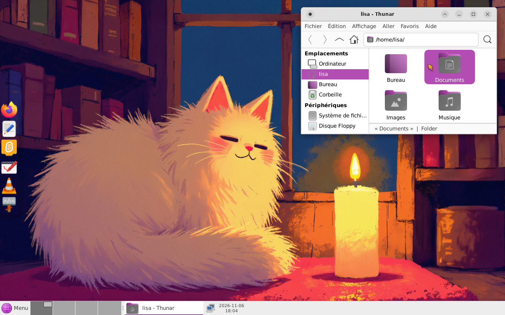

# debian-minimal-kids

Un système GNU/Linux minimaliste basé sur Debian, pensé pour les enfants :
simplicité, autonomie et initiation à l'informatique.



Construit avec [`live-build`](https://wiki.debian.org/DebianLive) à partir de
Debian 13 « trixie » (stable). Le bureau XFCE est en français, avec un
ensemble d'applications et de jeux en cours de constitution, ajoutés au fil
des choix du projet.

Applications : Firefox ESR, LibreOffice (texte, présentation), Gedit, Thunar,
VLC, Drawing, Galculator, Atril (PDF), Scratch (via Flathub).
Jeux : Extreme Tux Racer, Luanti, Atomix,
2048, Swell Foop.

## Construire

Prérequis sur la machine hôte : `live-build` et `debootstrap` (Debian, Ubuntu,
LMDE...).

```bash
sudo apt install live-build debootstrap
./build.sh          # équivaut à : sudo lb build
./clean.sh          # repartir de zéro (garde le cache des paquets)
```

Le résultat est `debian-minimal-kids-amd64.hybrid.iso` à la racine du projet.
Au démarrage du live : bureau XFCE en session automatique (`lisa` sur
`kids-pc`), en français (clavier AZERTY, fuseau Europe/Paris).

## Tester dans QEMU

```bash
qemu-system-x86_64 -enable-kvm -m 2048 -smp 2 \
  -cdrom debian-minimal-kids-amd64.hybrid.iso -boot d
```

Sans `/dev/kvm`, retirer `-enable-kvm`. Pour tester aussi l'installation sur
disque :

```bash
qemu-img create -f qcow2 kids-test.qcow2 20G
qemu-system-x86_64 -enable-kvm -m 2048 -smp 2 \
  -drive file=kids-test.qcow2,format=qcow2 \
  -cdrom debian-minimal-kids-amd64.hybrid.iso -boot d
```

Choisir l'entrée Install du menu de démarrage, puis relancer sans `-cdrom`
pour démarrer le système installé.

## Le bureau

Tout est défini dans `etc/skel/.config/` (via
`config/includes.chroot_after_packages/`), donc identique sur le live et sur
le système installé. Pour ajuster : modifier le bureau dans la session live,
puis recopier `~/.config/` modifié dans `etc/skel/` du dépôt.

- Panneau du bas (36 px) semi-transparent — teinte nuit à 55 %, texte blanc
  forcé par `gtk-3.0/gtk.css` pour la lisibilité : bouton Menu (icône
  `kids-menu-globe`, libellé « Menu »), bureaux, fenêtres, puis zone de
  notification et horloge épinglées à droite par un séparateur extensible.
  Des séparateurs transparents entre Menu et les bureaux, et en bout de
  panneau, donnent du « souffle ». L'horloge affiche
  « 7 novembre 2026, 22h 29 » (`%-d %B %Y, %Hh %M`, interprété par GLib).
- Dock vertical à gauche (48 px), transparent, ajusté à ses icônes :
  Firefox, Gedit, Scratch, Dessin, VLC, Thunar.
- Thème Yaru-magenta (GTK et icônes, paquets `yaru-theme-gtk` et
  `yaru-theme-icon`) ; bordures de fenêtres Yaru (les variantes colorées
  n'embarquent pas de décorations xfwm4) ; pointeur ComixCursors-Orange.
- Bureau sans icônes, fond d'écran « chat endormi à la bougie ».
- Thunar s'ouvre en vue liste par défaut (`thunar.xml` :
  `default-view` = `ThunarDetailsView`).
- Correcteur orthographique français : dictionnaires `hunspell-fr` +
  `hyphen-fr` installés (LibreOffice, gedit et Firefox les lisent) ; le
  surlignage de gedit est activé par défaut via un défaut système dconf
  (`etc/dconf/db/local.d/`). LibreOffice souligne automatiquement (fonction
  active d'origine, langue du document suivant la locale).

Détail des fichiers XFCE : disposition des panneaux et plugins dans
`xfce4-panel.xml` (chaque lanceur du dock est dans
`panel/launcher-<id>/`, le numéro correspond au plugin) ; thème GTK, icônes
et pointeur dans `xsettings.xml` ; bordures et compositeur dans `xfwm4.xml`
(nécessaire à la transparence) ; bureau sans icônes dans
`xfce4-desktop.xml`.

### Fond d'écran : comment ça marche

xfdesktop 4.20 range le fond sous une clé xfconf qui dépend du connecteur
réel du moniteur (`Virtual-1` en QEMU, `eDP-1`/`HDMI-1` sur du matériel) —
impossible à figer dans un XML. À la place, deux mécanismes complémentaires :

1. `usr/share/backgrounds/xfce/xfce-x.svg` est un lien symbolique vers notre
   image (`wallpaper.jpg`). Sans clé xfconf, xfdesktop affiche cette image
   par défaut sur tous les moniteurs, en remplissant l'écran (le format est
   détecté par le contenu, l'extension est sans importance).
2. `kids-set-wallpaper` (autostart de session) pose la clé `last-image` sur
   les moniteurs connectés : le choix est reflété dans l'outil « Bureau » et
   survit aux mises à jour du paquet `xfdesktop4-data`. Sans effet si un
   fond a déjà été choisi.

## Optimisations

Mémoire et réactivité :

- zram (`zram-tools`) : swap compressé en RAM — zstd, 50 % de la RAM
  (`etc/default/zramswap`), avec `vm.swappiness = 100` et
  `vm.page-cluster = 0` (`etc/sysctl.d/99-kids-zram.conf`).
- earlyoom : termine proprement le processus le plus gourmand avant le gel
  complet de la machine.
- ModemManager et NetworkManager-wait-online masqués (hook
  `0510-kids-performance.hook.chroot`, qui garantit aussi que zramswap et
  earlyoom sont actifs).

Démarrage :

- Squashfs en zstd (`auto/config`) : décompression ~5-10× plus rapide que le
  xz par défaut — principal poste du boot d'un live USB. Contrepartie :
  ISO ~10 % plus grosse (≈ 3,3 Go).
- Menu GRUB UEFI limité à 3 s (hook `0520-grub-timeout.binary`). Corrige un
  vrai bug : sans `set timeout`, GRUB attend indéfiniment une touche — le
  live ne démarrait pas seul sur les machines UEFI (invisible en test QEMU,
  qui passe par le BIOS où `timeout 0` boote immédiatement).
- GRUB_TIMEOUT = 1 s sur le système installé (`preseed.cfg`), contre 5 s par
  défaut.
- L'initrd est déjà optimal : préfixe microcode (cpio brut, standard Debian)
  puis archive principale zstd (défaut de trixie), vérifié dans l'ISO.

Délibérément non installés : `preload` (bénéfice non prouvé, consomme de la
RAM), `irqbalance` (marginal sur 2-4 cœurs), TLP (batterie, pas CPU/RAM).
Les vrais gros consommateurs restent les applications (Firefox,
LibreOffice). Après un build, affiner au réel avec `systemd-analyze`.

## Scratch

Scratch n'est pas packagé dans Debian : il est installé depuis Flathub
pendant le build (hook `0500-flatpak-scratch.hook.chroot`, paquet `flatpak`
déclaré dans `apps.list.chroot`). Contrepartie : le runtime GNOME requis
augmente sensiblement la taille de l'ISO.

## Structure du projet

| Chemin | Rôle |
|--------|------|
| `auto/config` | Options `lb config` figées : build reproductible |
| `config/package-lists/live.list.chroot` | Composants minimaux du live |
| `config/package-lists/locale.list.chroot` | Français : locale, clavier, dictionnaires (hunspell, hyphen), interfaces FR (LibreOffice, Firefox) |
| `config/package-lists/desktop.list.chroot` | XFCE, réseau, son, thème Yaru-magenta, curseurs, firmwares courants (Intel, Realtek, Atheros, SOF), dconf-cli, zram, earlyoom |
| `config/package-lists/apps.list.chroot` | Applications |
| `config/package-lists/games.list.chroot` | Jeux |
| `config/includes.installer/preseed.cfg` | Installateur en français, GRUB_TIMEOUT=1 |
| `config/hooks/normal/0500-flatpak-scratch.hook.chroot` | Scratch via Flathub |
| `config/hooks/normal/0510-kids-performance.hook.chroot` | zram + earlyoom actifs, ModemManager et NM-wait-online masqués |
| `config/hooks/normal/0520-grub-timeout.binary` | Menu GRUB UEFI : 3 s |
| `config/hooks/normal/0530-dconf-defaults.hook.chroot` | Compile les défauts dconf (surlignage orthographique gedit) |
| `config/includes.chroot_after_packages/etc/dconf/` | Profil dconf + défauts système (gedit : correcteur actif) |
| `config/includes.chroot_after_packages/etc/skel/` | Config XFCE, Thunar, GTK (panneaux, thème, gtk.css) |
| `config/includes.chroot_after_packages/etc/default/zramswap` | zram : zstd, 50 % de la RAM |
| `config/includes.chroot_after_packages/etc/sysctl.d/99-kids-zram.conf` | `vm.swappiness`, `vm.page-cluster` |
| `config/includes.chroot_after_packages/usr/share/backgrounds/` | Fond d'écran + lien `xfce-x.svg` |
| `config/includes.chroot_after_packages/usr/share/icons/hicolor/scalable/apps/kids-menu-globe.svg` | Icône du bouton Menu |
| `config/includes.chroot_after_packages/usr/local/bin/kids-set-wallpaper` | Pose `last-image` à l'ouverture de session |
| `build.sh` / `clean.sh` | Scripts pratiques |

## Réglages par défaut

| Paramètre | Valeur |
|-----------|--------|
| Langue | `fr_FR.UTF-8` |
| Clavier | `fr` (AZERTY) |
| Fuseau | `Europe/Paris` |
| Utilisateur | `lisa` |
| Machine | `kids-pc` |

Définis dans `auto/config` (paramètres `live-config.*`). L'installateur est
également préconfiguré en français : `preseed.cfg` et les paramètres
`--bootappend-install` d'`auto/config`.

## Pour la suite

- Applications : `config/package-lists/apps.list.chroot`, ou listes
  thématiques (p. ex. `education.list.chroot`).
- Réglages, thème, fond d'écran : `config/includes.chroot_after_packages/`.
- Personnalisation au démarrage, verrouillage parental : scripts dans
  `config/hooks/normal/`.
