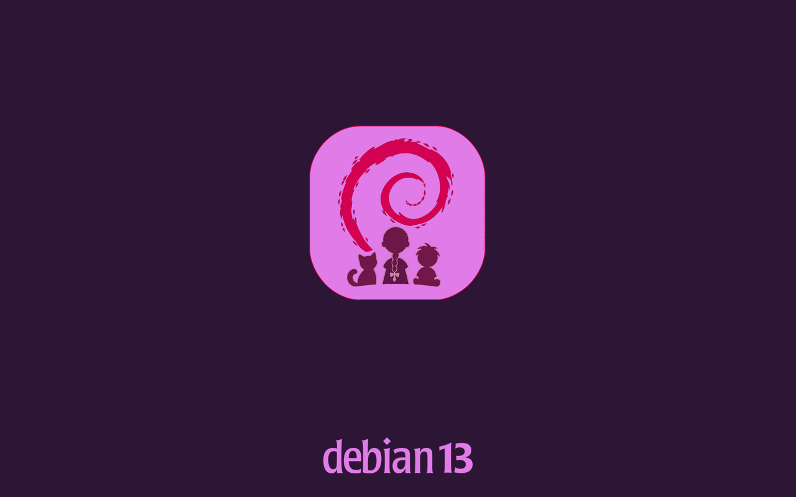

# debian-minimal-kids

Un système GNU/Linux minimaliste basé sur Debian 13 « trixie », pensé pour
les enfants : simplicité, autonomie et initiation à l'informatique.




Applications : Firefox ESR, LibreOffice (texte, présentation), Gedit,
Thunar, VLC, Drawing, Galculator, Atril (PDF), Scratch (en ligne).
Jeux : Extreme Tux Racer, Luanti, Atomix, 2048, Swell Foop.

## Construire

Prérequis : `live-build` et `debootstrap` (Debian, Ubuntu, LMDE...).

```bash
sudo apt install live-build debootstrap
./build.sh          # sudo lb build
./clean.sh          # repartir de zéro (garde le cache des paquets)
```

Résultat : `debian-minimal-kids-amd64.hybrid.iso`. Au démarrage du live :
XFCE en session automatique (`lisa` sur `kids-pc`), en français.

## Tester dans QEMU

```bash
qemu-system-x86_64 -enable-kvm -m 2048 -smp 2 \
  -cdrom debian-minimal-kids-amd64.hybrid.iso -boot d
```

Pour tester aussi l'installation : créer un disque
(`qemu-img create -f qcow2 kids-test.qcow2 20G`), l'ajouter avec
`-drive file=kids-test.qcow2,format=qcow2`, choisir l'entrée Install,
puis relancer sans `-cdrom`.

## Le bureau

Tout est dans `etc/skel/.config/` (via
`config/includes.chroot_after_packages/`), identique sur le live et le
système installé. Pour ajuster : modifier le bureau dans la session live,
puis recopier `~/.config/` dans `etc/skel/` du dépôt.

- Panneau du bas semi-transparent, texte blanc forcé par `gtk.css` pour la
  lisibilité : bouton Menu (globe violet), bureaux, fenêtres,
  notifications et horloge « 7 novembre 2026, 22h 29 » épinglées à droite.
- Dock vertical à gauche : Firefox, Gedit, Dessin, VLC, Thunar.
- Thème Yaru-magenta (GTK, icônes, bordures de fenêtres), pointeur
  ComixCursors-Orange, bureau sans icônes.
- Fond d'écran « chat endormi à la bougie » en mode zoom : remplit
  l'écran à toutes les résolutions, sans déformation.
- Écran de démarrage Plymouth « kids » : icône du projet sur tuile
  magenta, mention « debian 13 » (typographie Debian d'origine), adapté à
  toute résolution.
- Thunar en vue liste ; correcteur orthographique français actif partout
  (dictionnaires hunspell-fr, surlignage gedit activé via dconf).

Fichiers XFCE : panneaux dans `xfce4-panel.xml` (lanceurs dans
`panel/launcher-<id>/`), thème dans `xsettings.xml`, bordures et
compositeur dans `xfwm4.xml`, bureau dans `xfce4-desktop.xml`. Le fond est
posé par `kids-set-wallpaper` (autostart) car xfdesktop 4.20 le range sous
une clé dépendant du connecteur du moniteur.

## Firefox


Configuré par `etc/firefox/policies/policies.json` (politiques
d'entreprise) et `usr/lib/firefox-esr/distribution/distribution.ini`
(marque-pages de distribution).

- Marque-pages directement sur la barre personnelle (toujours visible) :
  dossiers Vidéos (YouTube, Disney+) et École (Khan Academy, Lumni,
  Scratch, 1jour1actu), Wikipédia en accès direct. Page d'accueil : Lumni.
- Moteur par défaut : Qwant Junior (résultats adaptés aux enfants, choix
  verrouillé). Assistant IA : Le Chat Mistral.
- Thème Alpenglow (dégradé violet/magenta) assorti au style de l'OS,
  appliqué au 1er lancement par AutoConfig (`kids.cfg`).
- Allégé : télémétrie, études, comptes et mises à jour internes
  désactivés ; importation de profil et popups mots de passe/formulaires
  désactivés ; pas de page de bienvenue.

## Contrôle parental

1. DNS familial : toutes les connexions passent par OpenDNS FamilyShield
   (`etc/NetworkManager/conf.d/99-kids-dns.conf`) ; les DNS du DHCP sont
   ignorés, pas de contournement depuis l'applet réseau.
2. Firefox verrouillé : DoH désactivé (il contournerait le DNS familial),
   `about:config` bloqué, navigation privée désactivée — l'historique
   reste consultable. La navigation normale est inchangée.
3. Couvre-feu : suspension à 21h30 (`etc/systemd/system/kids-bedtime.*`,
   activée par le hook 0510) ; au réveil la session est verrouillée (mot
   de passe de lisa). L'inactivité ne verrouille jamais l'écran.

Changer l'heure : éditer `OnCalendar` du timer puis
`sudo systemctl daemon-reload && sudo systemctl restart kids-bedtime.timer`.
Désactiver : `sudo systemctl disable --now kids-bedtime.timer`.
Limites : contournable avec le mot de passe administrateur ; inopérant sur
le live (connexion automatique) ; une machine démarrée après 21h30
s'endort le lendemain.

## Optimisations

- zram (zstd, 50 % de la RAM) + earlyoom ; `vm.swappiness = 100`
  (`etc/sysctl.d/99-kids-zram.conf`). ModemManager et NM-wait-online
  masqués (hook 0510).
- Squashfs zstd (boot rapide), menu GRUB UEFI à 3 s (hook 0520, corrige
  un blocage au démarrage sur UEFI), GRUB_TIMEOUT = 1 sur le système
  installé.
- ISO contenue : firmwares limités à l'utile (wifi, audio, iGPU), caches
  apt-file/xapian/plocate non construits (hooks live-build par défaut
  désactivés), paquets superflus purgés (hook 0540).

## Structure du projet

| Chemin | Rôle |
|--------|------|
| `auto/config` | Options `lb config` figées |
| `config/package-lists/*.list.chroot` | Paquets : live, locale FR, bureau, applications, jeux |
| `config/includes.installer/preseed.cfg` | Installateur en français |
| `config/hooks/normal/0510-kids-performance.hook.chroot` | zram, earlyoom, couvre-feu actifs ; services inutiles masqués |
| `config/hooks/normal/0520-grub-timeout.binary` | Menu GRUB UEFI : 3 s |
| `config/hooks/normal/0530-dconf-defaults.hook.chroot` | Compile les défauts dconf |
| `config/hooks/normal/0540-kids-slim.hook.chroot` | Purge les paquets superflus tirés par les « Recommends » |
| `config/hooks/normal/0550-plymouth-theme.hook.chroot` | Embarque le thème Plymouth « kids » dans l'initramfs |
| `config/includes.chroot_after_packages/etc/` | DNS familial, politiques Firefox, Plymouth, couvre-feu, dconf, skel XFCE |
| `config/includes.chroot_after_packages/usr/lib/firefox-esr/distribution/` | Marque-pages de la barre personnelle |
| `config/includes.chroot_after_packages/usr/lib/firefox-esr/kids.cfg` | AutoConfig : applique le thème Alpenglow |
| `config/includes.chroot_after_packages/usr/share/` | Fond d'écran, icône du Menu, thème Plymouth |
| `build.sh` / `clean.sh` | Scripts pratiques |

## Réglages par défaut

| Paramètre | Valeur |
|-----------|--------|
| Langue / clavier | `fr_FR.UTF-8` / `fr` (AZERTY) |
| Fuseau | `Europe/Paris` |
| Utilisateur / machine | `lisa` / `kids-pc` |

Définis dans `auto/config` (`live-config.*`) ; l'installateur est
préconfiguré en français (`preseed.cfg`).
